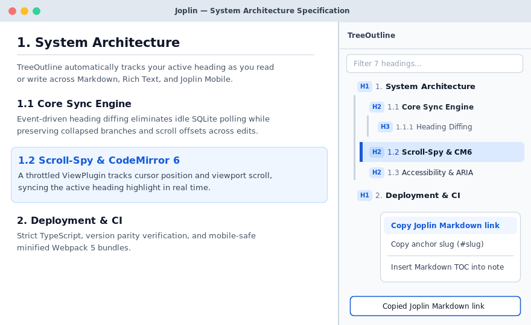
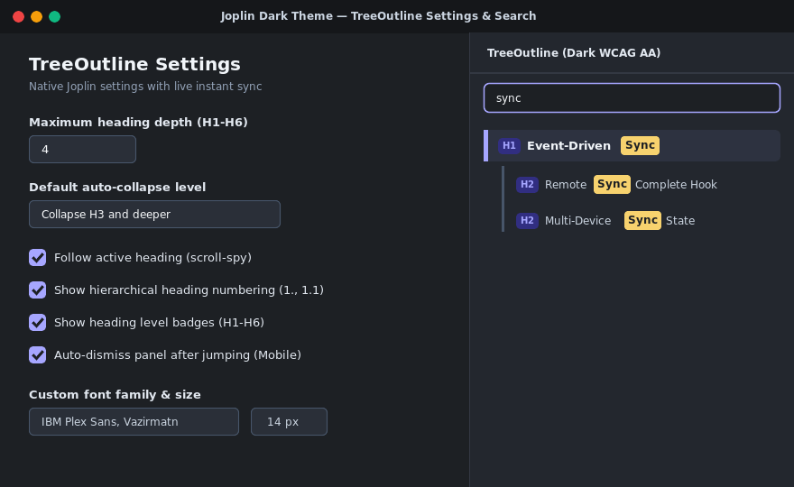

# TreeOutline for Joplin

[](https://joplinapp.org/)
[](#-installation)
[](https://opensource.org/licenses/MIT)

TreeOutline is a hierarchical outline and table of contents panel for Joplin desktop and mobile. It parses Markdown and HTML note headings into a collapsible, searchable, keyboard-accessible tree with active heading scroll-spy, quick link/TOC actions, native Joplin settings, and bidirectional RTL/LTR support.



---

## Features

- **Active Heading Scroll-Spy:** Automatically highlights and scrolls the currently active section into view inside TreeOutline as you read or write across CodeMirror 6 and the rendered Markdown Viewer (with collapsed-ancestor accent indicators).
- **Native Joplin Settings Panel:** Configure everything live under **Tools > Options > TreeOutline** (macOS: **Joplin > Preferences > TreeOutline**):
  - Maximum heading depth (`H1`–`H6`)
  - Default auto-collapse level (e.g., collapse `H3+` automatically on long notes)
  - Follow active heading (scroll-spy toggle)
  - Hierarchical heading numbering (`1.`, `1.1`, `1.2`)
  - Subtle heading level badges (`H1`–`H6`)
  - Text wrap default (`Auto`, `Always wrap`, `Single line`)
  - Font preset, optional custom font family override, and custom font size (`10px`–`24px`)
  - Auto-dismiss panel after jumping on Joplin Mobile
- **Copy Heading Links & Insert Markdown TOC:** Hover any heading to copy Joplin's native internal Markdown link (`[Heading Title](:/noteId#slug)`), right-click (or press `Shift+F10`) to copy `[Title](:/noteId#slug)` or `#slug`, or insert a complete Markdown Table of Contents via the toolbar button, context menu, or Command Palette (`Insert Markdown Table of Contents (TreeOutline)`).
- **Accessible Keyboard Navigation & Theme Polish:** Full W3C APG ARIA tree semantics (`ArrowUp/Down/Left/Right`, `Home`, `End`, `*`, `Enter`/`Space`, `Shift+F10`), roving `tabindex`, WCAG AA adaptive Joplin theme contrast, and RTL-mirrored navigation.
- **Bi-directional Layout (RTL & LTR):** Automatically detects Persian, Arabic, Hebrew, and Latin scripts per note with mirrored indent guides, chevrons, and exact ZWNJ/diacritic search highlighting.
- **Editor, Viewer & Mobile Sync:** Seamless jumping in CodeMirror 6, legacy CodeMirror 5, Rich Text Editor (TinyMCE), Markdown Viewer, and Joplin Mobile (Android & iOS) with clear multi-note selection feedback.
- **Zero-Polling & Lightweight:** Strictly event-driven with zero `setInterval` timers, zero external runtime frameworks, and minified mobile-safe bundles.



---

## Installation

### From Joplin (Recommended)
1. Open Joplin and go to **Tools > Options > Plugins** (macOS: **Joplin > Preferences > Plugins**).
2. Search for `TreeOutline`.
3. Click **Install** and restart Joplin.

### Manual Installation
1. Download the latest `com.xyasharx.treeoutline.jpl` file from the [Releases](https://github.com/xyasharx/joplin-plugin-tree-outline/releases) page.
2. In Joplin, go to **Tools > Options > Plugins** (macOS: **Joplin > Preferences > Plugins**).
3. Click the gear icon (`⚙`) next to *Manage your plugins* and choose **Install from file**.
4. Select the `.jpl` file and restart Joplin.

---

## Usage

- **Toggle Panel:** On desktop (macOS, Windows, and Linux), show or hide TreeOutline using:
  - The **Toggle TreeOutline** button in the top-right note toolbar.
  - **Tools > Toggle TreeOutline** in the menu bar.
  - The Command Palette (`Ctrl+Shift+P` / macOS: `Cmd+Shift+P`) → **Toggle TreeOutline**.
  - Custom shortcut under **Tools > Options > Keyboard Shortcuts** (`Toggle TreeOutline`).
- **Quick Copy & Context Menu:** Click the link icon on any hovered heading to copy its internal Joplin link (`[Title](:/noteId#slug)`), or right-click / press `Shift+F10` to choose **Copy Joplin Markdown link**, **Copy `#slug` anchor**, or **Insert Markdown TOC**.
- **Insert Markdown TOC:** Click the list icon in the TreeOutline toolbar or run **Insert Markdown Table of Contents (TreeOutline)** from the Command Palette. When editing a note, the TOC is inserted at the cursor; in viewer-only mode, it is copied directly to your clipboard.
- **Mobile:** Open or dismiss the outline from Joplin Mobile's built-in **Plugin panels** button.
- **Search & Collapse:** Click the magnifying glass icon to filter headings (`Escape` clears search), or click the fold icon to collapse/expand all sections at once.

---

## Building & Testing from Source

Requirements: Node.js (v20+) and npm.

```bash
# Clone the repository
git clone https://github.com/xyasharx/joplin-plugin-tree-outline.git
cd joplin-plugin-tree-outline

# Install dependencies
npm install

# Run full verification (version parity, strict TypeScript, build & tests)
npm run check:version
npm run typecheck
npm test
```

The compiled package is generated at `publish/com.xyasharx.treeoutline.jpl`.

---

## License

MIT
